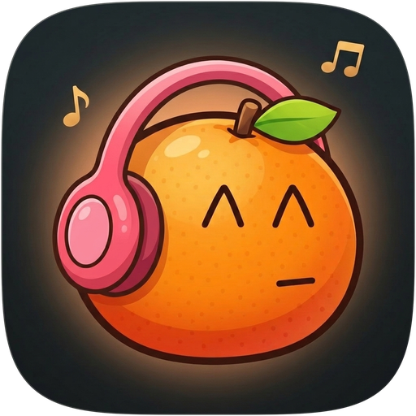
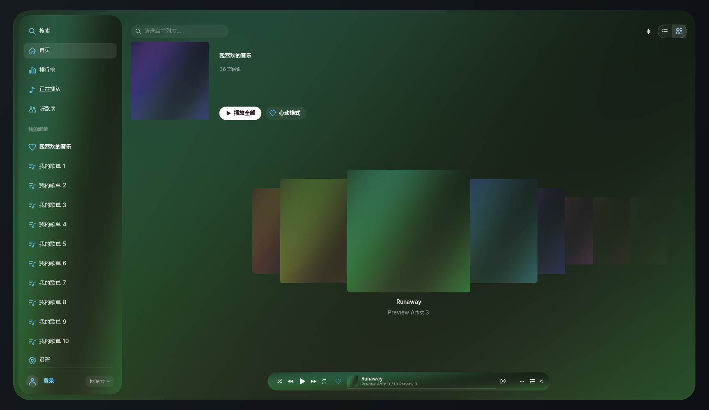
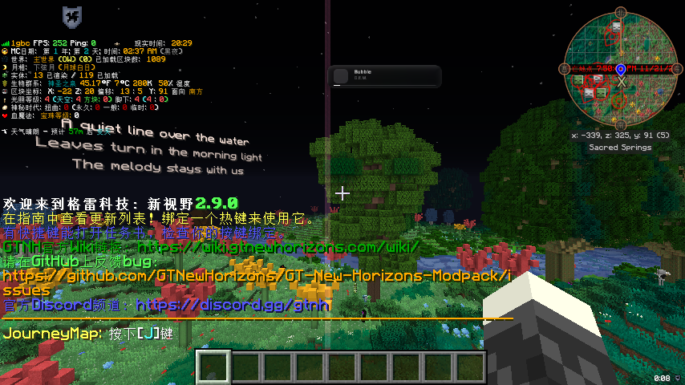
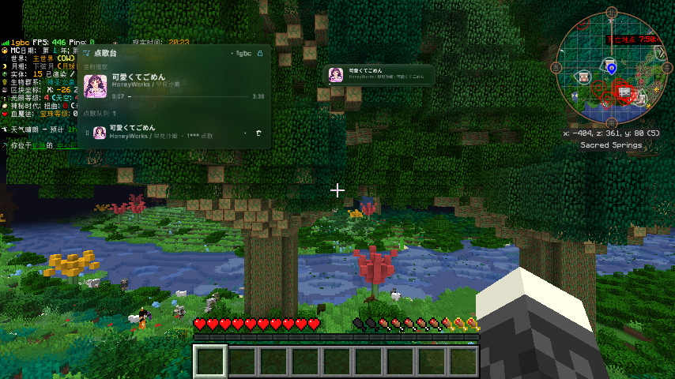

# DangoMusic Community Edition

在 GT New Horizons 里听网易云音乐和 Apple Music。支持游戏内歌词、灵动岛、听歌房，以及 B 站直播弹幕点歌。

[下载最新正式版](https://github.com/1gbc/DangoMusic-CommunityEdition/releases/latest) · [更新记录](CHANGELOG.md) · [反馈问题](https://github.com/1gbc/DangoMusic-CommunityEdition/issues/new/choose)

## 安装与打开播放器

1. 使用 **GTNH 2.9.0 / Minecraft 1.7.10 / Forge 10.13.4.1614**，保留整合包原有的 Java 和启动设置。
2. 退出游戏，从 [正式版下载页](https://github.com/1gbc/DangoMusic-CommunityEdition/releases/latest) 下载 `dangomusicce-<版本号>.jar`，放进对应实例的 `mods/`。升级时移走旧版 JAR，并保留原来的 Mod 配置和登录资料。
3. 进入 **选项 → 控制 → DangoMusic Community Edition**，绑定「打开 / 关闭播放器」。在游戏中按下你绑定的按键，在播放器侧栏左下角选择网易云或 Apple Music。
4. 在侧栏搜索歌曲或打开歌单。列表模式单击歌名可以选中歌曲，点击小封面上的播放按钮即可播放。底部控制栏可以暂停、切歌、调整进度、音量或查看播放队列。

## 从 DangoMusic GTNH Edition 升级

本项目原名 **DangoMusic GTNH Edition**，现在改名为 **DangoMusic Community Edition**（mod ID 从 `dangomusicgtnh` 改为 `dangomusicce`）。

1. 退出游戏，删除 `mods/` 里旧的 `dangomusicgtnh-*.jar`，放入新的 `dangomusicce-*.jar`。两个不要同时放。
2. 第一次启动时，`config/dangomusicgtnh/` 里的设置、字体和歌词会自动复制到 `config/dangomusicce/`；网易云、QQ、Apple 的登录资料和自定义快捷键也会带过来，一般不用重新登录。
3. 旧目录不会被删除，确认没问题后可以自己删掉。
4. 服务器和所有玩家要一起升级：新旧版本之间不能使用附近共享和听歌房。服务器上的听歌房记录会跟着设置一起复制。

## 音源、歌单和播放队列

| 功能 | 怎么用 |
| --- | --- |
| **网易云音乐** | 扫码登录后可使用个人歌单、我喜欢、每日推荐、私人 FM 等入口。在「我喜欢」可启动心动模式。 |
| **Apple Music** | 在 Windows x64 电脑上安装 .NET 8 Desktop Runtime 和 WebView2 Evergreen Runtime，然后切换音源并在弹出的 Apple 窗口登录。内置播放组件会自动启动。 |
| **待播队列** | 点击底栏的队列图标，按住歌曲拖动重排。切换到歌单封面模式后，单击封面可以直接播放，也可以拖动封面队列，停稳后播放居中的歌曲。 |
| **收藏到歌单** | 点击播放控制栏的三点菜单，选「收藏到歌单」并选择可写入的歌单。网易云的爱心对应「我喜欢」。 |
| **缓存与续播** | 网易云支持下一首预取、本地音频缓存及退出后恢复上次播放状态。在设置中可查看缓存占用和文件数，也可清理缓存。 |

播放与收藏权限由各音源和账号决定。Apple Music 正常播放需要有效订阅和当地曲库权限。Apple Music 的搜索、队列和歌词界面在游戏内，授权与受保护音频播放由后台 WebView2 组件处理。 [安装运行时](https://dotnet.microsoft.com/download/dotnet/8.0) · [安装 WebView2](https://developer.microsoft.com/microsoft-edge/webview2/)

*歌单封面模式（界面演示）。右上角切换列表或封面视图，点击中央或两侧封面可播放，拖动也可以浏览整条队列。*

## 歌词与灵动岛

- **大歌词页**。点击底栏当前歌曲的封面进入。Apple Music 可从歌词页三点菜单单独切换「音译」和「翻译」。
- **3D 歌词**。在「设置 → 歌词」选择 3D 样式。可调字体、大小、配色、发光、行数和逐词效果。多行模式位于镜头左侧并保持透视角度。翻译、音译和 KTV 效果取决于歌曲提供的歌词数据。
- **驾驶舱歌词**。在「设置 → 歌词」切到驾驶舱样式，独立调整位置、字体、行数、颜色和发光。
- **灵动岛**。在「设置 → 界面与 HUD → 灵动岛」选择布局和背景。提供液态玻璃、深色玻璃和封面流动。位置默认锁定。先在设置中解锁，再按住「HUD 鼠标交互」（默认左 Alt）拖动。关闭点歌台时也可以调出鼠标，已有自定义绑定会保留。

*GTNH 开发版实机截图。多行 3D 歌词在屏幕左侧显示，顶部的灵动岛显示当前曲目。*

## B 站直播点歌台

点歌台目前使用网易云音源。主播端需要 **Windows x64** 和 **.NET 8 Runtime**。启用点歌台后，游戏会按设置启动 JAR 内置的弹幕助手。

1. 开播后复制直播链接中的房间号。播放器切到网易云音源，打开「设置 → 界面与 HUD → B 站直播点歌台」。
2. 开启点歌台，填写房间号。Mod 会把房间号存到本机。每次启动游戏后手动开启点歌台，就会自动连接上次填写的房间。
3. 观众在 B 站直播间发送以下任意一种指令。

| 指令用法 | 示例 |
| --- | --- |
| 按歌名 | `/song 青のすみか` |
| 按歌名和歌手 | `/song 泡沫-邓紫棋` |
| 按网易云歌曲 ID | `/song 3459356843` |
| 按网易云单曲链接 | `/song https://music.163.com/song?id=3459356843` |
| 使用旧指令 | `/点歌 青のすみか キタニタツヤ` |

歌名匹配到多个版本时，卡片底部会显示候选的歌手、专辑和歌曲 ID 指令。主播按住 **左 Alt** 后，点击候选按钮的左侧「列表＋加号」，可将该版本直接加入点歌队尾并开始缓存。点击右侧会复制完整的 `/song 歌曲ID` 指令，可粘贴到 B 站弹幕。若 B 站客户端截断分享链接，也可直接发送歌曲 ID。

歌曲入队后会提前缓存。当前歌曲结束，或主播手动点「下一首」时，优先播放待播点歌。队首最多等待缓存 10 秒，超时或无法播放会提示并跳过。点歌播完后继续原歌单。按住**左 Alt**可以释放鼠标、拖动队列排序、点击封面上的播放按钮提前播放，或点垃圾桶删除。也可以拖动已解锁的点歌卡片贴到屏幕边缘。

连接有问题时，核对直播间号后点「重新连接」。需要先验证 Mod 内部流程时，可以开启「模拟弹幕」并发送示例。 [点歌台详细指南](tools/bilibili-live-helper/README.md)

*GTNH 开发版实机截图。卡片上半部分是当前播放与进度，下半部分是点歌队列。按住交互键后可以拖动排序或点击垃圾桶删除。*

## 联机、设置和反馈

- **附近共享**。服务端和参与的客户端都装同版本 Mod。进入「设置 → 多人」开启共享或收听。同一服务器、同维度的附近玩家可以听歌或看歌词投影。
- **听歌房**。从侧栏的「听歌房」创建房间、加入或邀请同服玩家。房间收听覆盖同服不同距离。 [多人使用指南](docs/NEARBY_SHARING.md)
- **设置搜索与导出**。设置页顶部可模糊搜索选项。「导出设置」保存为 `settings.json`。关闭目标实例后，可用文件覆盖其 `config/dangomusicce/settings.json`。B 站房间号保存在本机单独的文件里。
- **反馈**。附上 GTNH 和 Mod 版本、音源、复现步骤和脱敏日志。安全问题可按项目的安全指南私下报告。 [安全指南](SECURITY.md) · [提交问题](https://github.com/1gbc/DangoMusic-CommunityEdition/issues/new/choose)

## 项目来源与开发

本项目是 Sorihiko 的 DangoMusic 的非官方 GTNH 移植版，以 GPL-3.0 发布。 [上游项目](https://github.com/Sorihiko/DangoMusic) · [移植起点 v1.7.3](https://github.com/Sorihiko/DangoMusic/tree/1e82730e6cbf19301e33cc6901f210bcffe9ea2c)

开发者可使用 JDK 25 运行 Gradle、JDK 8 作为编译工具链、.NET 8 SDK 构建内置组件。 [贡献指南](CONTRIBUTING.md) · [致谢](CREDITS.md) · [第三方许可](THIRD_PARTY_NOTICES.md) · [许可证](LICENSE)
