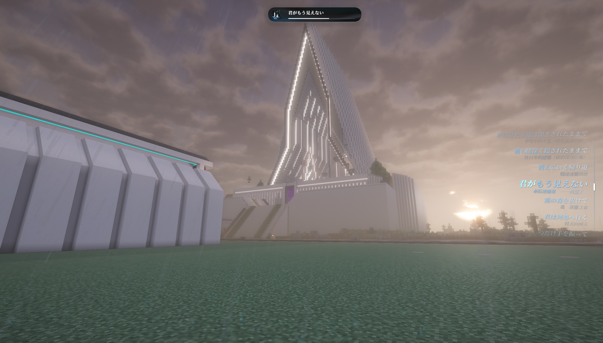

# DangoMusic Community Edition

玩 GTNH 肝产线、等合成、挂机器的时候太安静？不如直接把网易云音乐和 Apple Music 搬进 Minecraft 1.7.10 里。

这个 Mod 专为 **GT New Horizons** 打造，支持游戏内选歌建队、3D 世界歌词、驾驶舱歌词、顶部灵动岛、B 站直播间弹幕点歌，还能和同服好友开听歌房一起听。**纯客户端单装就能用**，服务端只在需要多人同步听歌时才要装。

[下载最新正式版](https://github.com/1gbc/DangoMusic-CommunityEdition/releases/latest) · [更新记录](CHANGELOG.md) · [反馈问题](https://github.com/1gbc/DangoMusic-CommunityEdition/issues/new/choose)

## 快速上手

1. **确认环境**：适用于 **GTNH 2.9.0 / Minecraft 1.7.10 / Forge 10.13.4.1614**，直接沿用整合包原本的 Java 和启动参数即可，不用额外魔改。

2. **安装 Mod**：退出游戏，前往 [正式版下载页](https://github.com/1gbc/DangoMusic-CommunityEdition/releases/latest) 下载 `dangomusicce-<版本号>.jar`，放进实例的 `mods/` 目录（升级时记得删掉旧版本 JAR）。

3. **打开播放器**：进游戏后按 `M`（默认快捷键，可在按键设置里改）打开菜单，在侧栏左下角选择「网易云音乐」或「Apple Music」。

4. **选歌与切歌**：

   * 在歌单或搜索列表里**单击**选中歌曲，**双击歌曲行**或**点击小封面上的播放按钮**即可开播（就算先用关键词筛选了列表，双击依然会把整张歌单建立为播放队列）。

   * 底部控制栏负责暂停、切歌、拖拽进度条、调音量和查看待播队列。

## 从旧版（DangoMusic GTNH Edition）升级

项目从 0.6.0 起正式改名为 **DangoMusic Community Edition**，Mod ID 也从 `dangomusicgtnh` 换成了 `dangomusicce`。

* 退出游戏，删掉 `mods/` 里旧的 `dangomusicgtnh-*.jar`，放入新的 `dangomusicce-*.jar`（**千万别两个同时留着**）。

* 首次启动会自动把 `config/dangomusicgtnh/` 下的配置、字体、歌词，以及网易云/QQ/Apple 登录资料和自定义按键迁移到 `config/dangomusicce/`，通常不需要重新登录。

* 旧目录不会被删除，确认一切正常后再手动清理就行。

* 如果有联机需求，**服务端和所有玩家必须一起升级**——新旧版本的联机通道不互通，无法使用附近共享和听歌房。

## 音源、曲库与播放体验

| 模块 | 能做什么 / 怎么用 |
| ----- | ----- |
| **网易云音乐** | 扫码登录后直接用个人歌单、我喜欢、每日推荐、私人 FM；在「我喜欢」里可以开心动模式，也能在播放器里看歌曲评论。 |
| **Apple Music** | Windows x64 玩家装好 [.NET 8 Desktop Runtime](https://dotnet.microsoft.com/download/dotnet/8.0) 和 [WebView2 Evergreen Runtime](https://developer.microsoft.com/microsoft-edge/webview2/) 后，切到 Apple Music 音源并在弹出窗口登录即可。搜索、队列和歌词都在游戏内，授权与受保护音频由内置 WebView2 组件在后台处理（需有效订阅和对应地区曲库权限）。 |
| **待播队列与封面流** | 点底栏队列图标可打开待播列表，按住歌曲就能上下拖拽重排。切到**歌单封面模式**后，点封面直接开播，也可以左右拖动整条封面队列，停稳后自动播居中的那一首。 |
| **收藏到歌单** | 点播放控制栏的三点菜单，选择「收藏到歌单」即可放进可写入的歌单；网易云这边点爱心对应「我喜欢」。 |
| **缓存、续播与音质** | 网易云支持下一首预取、本地磁盘缓存和退出后恢复上次播放进度（在设置里能查看缓存大小与文件数，随时清理）。音频引擎内置 FLAC / Ogg Vorbis 解码、切歌淡入淡出、防爆音软限幅（Soft Limiter），还带有环境音效与房间声学模拟。 |

*歌单封面模式实机演示：右上角切换列表或封面视图，点击或拖动封面都能直接切歌。*

## 歌词与 HUD 界面

整个界面基于自定义 OpenGL 着色器做了毛玻璃和发光质感，既好看又不会太挡视野，同时保留了对旧版界面与按键绑定的兼容：

* **大歌词页**：点底栏当前播放歌曲的封面就能进。用 Apple Music 时，还能从歌词页右上角三点菜单单独开关「音译」和「翻译」。

* **3D 世界歌词**（`设置 → 歌词 → 3D 歌词 · 基础`）。「同时显示句数」可选 1–4 句，待唱歌词越接近开唱越亮。选 2 句或更多后，可切换「散落漂浮」和「诗节排版」。散落模式让歌词分开漂浮，靠近时会平滑错开。诗节排版把几句放在一起，下一组在另一侧预告，转头时两组靠近会相互避让。两种排版都能调文字倾角，诗节排版还可以开关「歌词唱完即消失」。

* **调试模式与自由视角**。在游戏里点设置页顶部的「调试模式」，就能一边看歌词、灵动岛和点歌台，一边调它们的样式与位置。拖动调试台标题栏可以挪位置。点「自由视角」后用移动键和鼠标换个角度看，按 `Tab` 或 `Esc` 回调试台。两种模式都能用已绑定的播放、暂停和切歌快捷键。

* **驾驶舱歌词**（`设置 → 歌词`）：偏侧边 HUD 风格的歌词栏，位置、字体、行数、颜色和发光全都可以独立设置。按住 HUD 鼠标键（默认**左 Alt**）把鼠标挪到歌词上，指哪句亮哪句，滚轮上下翻看前后歌词，**单击直接从那一句开始唱**（点歌名行则从头重播）。

* **灵动岛**（`设置 → 灵动岛与点歌台 → 灵动岛`）：在屏幕顶部显示当前曲目与进度，提供「液态玻璃」「深色玻璃」「封面流动」三种样式。默认位置锁定，在设置里解锁后按住**左 Alt**就能随便拖。

* **F1 隐藏界面显示总览**（`设置 → 通用与外观`）。可以决定按 `F1` 后是否保留灵动岛、点歌台、歌词和附近共享提示。3D 歌词和驾驶舱歌词共用一个开关，默认保留显示。点歌台隐藏时仍会接单。

* **自定义字体**。3D 歌词、驾驶舱歌词和灵动岛都能单独换字体。找到对应的字体设置，点旁边的小文件夹图标，把解压后的字体文件放进去，再回到游戏里从列表选上就行。平时日文歌、英文歌听得多的话，可以试试免费的[装甲明朝](https://github.com/1gbc/DangoMusic-CommunityEdition/releases/download/0.6.3/SoukouMincho-Font.zip)。

*GTNH 实机截图，顶部的灵动岛歌词胶囊和右侧的驾驶舱歌词都用了装甲明朝。*

## B 站直播弹幕点歌台

如果你在 B 站直播玩 GTNH，可以直接把点歌台开起来让水友点歌（目前走网易云音源，主播端需要 **Windows x64** + **.NET 8 Runtime**，JAR 已内置弹幕助手）。

1. 开播后复制直播间号，游戏里切到网易云音源，打开 `设置 → 灵动岛与点歌台 → B 站直播点歌台`。

2. 打开点歌台开关并填入房间号。房间号会保存在本机，下次启动游戏后只要手动打开点歌台开关，就会自动连回上次的房间。

3. 观众在直播间发以下任意弹幕即可点歌：

| 点歌方式 | 弹幕示例 |
| ----- | ----- |
| 按歌名 | `/song 青のすみか` |
| 按歌名 + 歌手 | `/song 泡沫-邓紫棋` |
| 按网易云歌曲 ID | `/song 3459356843` |
| 按网易云单曲链接 | `/song https://music.163.com/song?id=3459356843` |
| 兼容旧指令 | `/点歌 青のすみか キタニタツヤ` |

* **多版本选择**：搜到多个版本时，点歌卡片底部会列出候选按钮。主播按住**左 Alt**点击按钮左侧「列表＋加号」，就能把对应版本直接塞进点歌队尾并开始预缓存；点击右侧则会复制完整的 `/song 歌曲ID` 指令方便贴回弹幕。

* **插队、缓存与拖拽**：点歌入队后会提前缓存，当前歌曲播完或主播点「下一首」时优先播待播点歌（队首最多等 10 秒缓存，超时或不可播会提示并跳过），点歌全播完后再无缝接回原歌单。按住**左 Alt**可以拖动队列排序、点封面提前播放、点垃圾桶删歌，也能拖动解锁后的卡片贴到屏幕边缘。

* **本地排障**：连不上时核对房间号点「重新连接」即可；想先测流程可以打开设置里的「模拟弹幕」自己发一条试试。更多细节见 [点歌台详细指南](tools/bilibili-live-helper/README.md)。

*GTNH 实机截图：卡片上半部分是当前播放与进度，下半部分是待播点歌队列，按住左 Alt 就能拖拽排序或删歌。*

## 多人联机与设置管理

* **附近共享**：服务端和参与的玩家都装上同版本 Mod，进 `设置 → 多人` 打开共享或收听，同服同维度的附近玩家就能一起听歌、看 3D 歌词投影。

* **听歌房**：在侧栏「听歌房」建房、加入或邀请同服玩家，不受距离限制同步开听（支持服务端配置与 `/dangomusic` 指令）。完整用法见 [多人使用指南](docs/NEARBY_SHARING.md)。

* **设置搜索与迁移**。设置页分为「通用与外观」「播放与音效」「歌词」「灵动岛与点歌台」「趣味与联机」和「快捷键」。按 `Ctrl+F` 可以跨分类找选项，「歌词」里还有小圆角下拉菜单可快速切换预设。「导出设置」会生成 `settings.json`，关掉目标实例后可用它替换目标实例的 `config/dangomusicce/settings.json`。B 站房间号单独保存在本机。

* **小彩蛋**：播放音乐时支持角色舞蹈动作联动。

## 反馈与开发信息

* **反馈问题**：遇到 Bug 请去 [Issues](https://github.com/1gbc/DangoMusic-CommunityEdition/issues/new/choose) 提单，记得附上 GTNH 版本、Mod 版本、使用的音源、复现步骤和脱敏日志；涉及安全问题请先看 [安全指南](SECURITY.md) 私下联系。

* **项目来源**：本项目是 [Sorihiko/DangoMusic](https://github.com/Sorihiko/DangoMusic)（[移植起点 v1.7.3](https://github.com/Sorihiko/DangoMusic/tree/1e82730e6cbf19301e33cc6901f210bcffe9ea2c)）的非官方 GTNH 移植版，以 **GPL-3.0** 协议开源。

* **开发构建**：使用 JDK 25 运行 Gradle、JDK 8 作为编译工具链（Kotlin 2.2.21），并用 .NET 8 SDK 构建内置 Windows 辅助组件。

[贡献指南](CONTRIBUTING.md) · [致谢](CREDITS.md) · [第三方许可](THIRD_PARTY_NOTICES.md) · [许可证](LICENSE)
